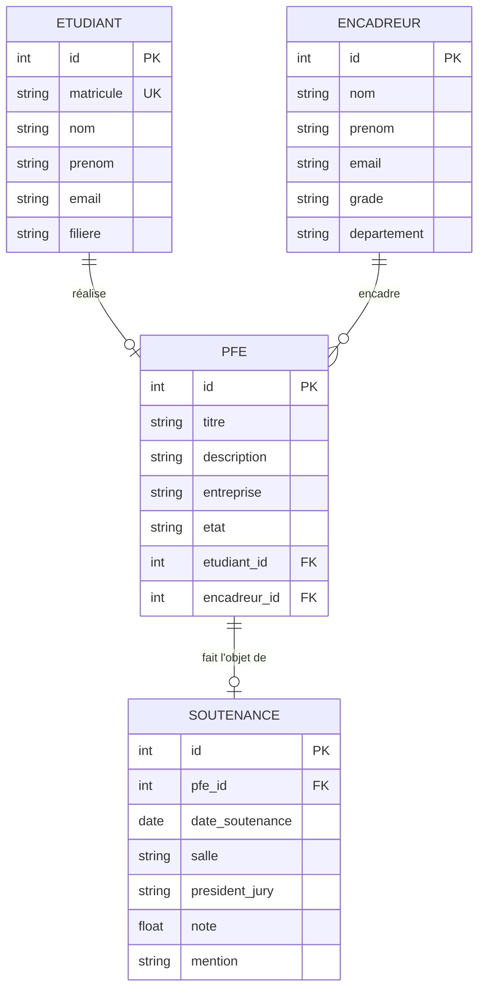

# Système de Gestion des Projets de Fin d'Études (PFE)

[](https://www.oracle.com/java/)
[](https://docs.oracle.com/javase/tutorial/uiswing/)
[](https://www.mysql.com/)
[](https://maven.apache.org/)
[](https://opensource.org/licenses/MIT)

> **Application bureautique de gestion académique des Projets de Fin d'Études (PFE), soutenances, étudiants et encadreurs.**  
> Conçue avec une architecture modulaire **MVC / DAO** en Java Swing avec persistance relationnelle MySQL via JDBC.

---

## 📌 Présentation du Projet

Cette application offre une interface graphique complète permettant aux départements universitaires d'automatiser et de centraliser le cycle de vie complet des Projets de Fin d'Études :
- Inscription et suivi des **Étudiants**.
- Gestion du corps des **Encadreurs universitaires**.
- Attribution et suivi de l'état des **Sujets de PFE** (*Proposé*, *En cours*, *Validé*, *Soutenu*).
- Planification rigoureuse des **Soutenances** (Date, Heure, Salle, Jury, Note finale et Mention).

---

## 🏗️ Architecture Technique

Le projet adopte le patron de conception **DAO (Data Access Object)** garantissant un découplage propre entre l'interface utilisateur, la logique métier et la couche de données.

```
src/main/java/tn/pfe/gestion/
├── App.java                     # Point d'entrée de l'application
├── db/
│   └── DbConnection.java        # Gestionnaire de pool/connexions Singleton JDBC
├── model/
│   ├── Etudiant.java            # Entité Étudiant
│   ├── Encadreur.java           # Entité Encadreur
│   ├── Pfe.java                 # Entité Sujet PFE
│   ├── PfeEtat.java             # Énumération des états PFE
│   └── Soutenance.java          # Entité Soutenance & Jury
├── dao/
│   ├── EtudiantDao.java         # Opérations CRUD Étudiants
│   ├── EncadreurDao.java        # Opérations CRUD Encadreurs
│   ├── PfeDao.java              # Opérations CRUD & filtres PFE
│   └── SoutenanceDao.java       # Opérations CRUD & vérifications Soutenances
├── ui/
│   ├── MainMenuFrame.java       # Menu principal du tableau de bord
│   ├── EtudiantFrame.java       # Formulaire & table des étudiants
│   ├── EncadreurFrame.java      # Formulaire & table des encadreurs
│   ├── PfeFrame.java            # Formulaire d'affectation des PFE
│   └── SoutenanceFrame.java     # Planification des jurys et soutenances
└── util/
    ├── Constants.java
    ├── ErrorHandler.java
    └── Validators.java
```

---

## 🗄️ Schéma de la Base de Données

Le schéma relationnel est optimisé avec intégrité référentielle (`FOREIGN KEY` avec contraintes `ON DELETE CASCADE / SET NULL`) :



Les scripts d'initialisation et d'amorçage sont fournis dans le dossier `database/` :
- `database/schema.sql` : Création des tables et index.
- `database/seed_data.sql` : Jeu de données de test complet.

---

## 🚀 Installation & Démarrage

### 1. Prérequis
- **JDK 17** (ou JDK 8+)
- **Apache Maven 3.8+**
- **MySQL Server 8.0+**

### 2. Configuration de la Base de Données
Créez la base de données et exécutez les scripts SQL :
```bash
mysql -u root -p -e "CREATE DATABASE IF NOT EXISTS gestion_pfe CHARACTER SET utf8mb4;"
mysql -u root -p gestion_pfe < database/schema.sql
mysql -u root -p gestion_pfe < database/seed_data.sql
```

Ajustez les identifiants de connexion dans `src/main/resources/db.properties` si nécessaire :
```properties
db.url=jdbc:mysql://localhost:3306/gestion_pfe?useSSL=false&serverTimezone=UTC
db.user=root
db.password=
```

### 3. Compilation et Exécution avec Maven
```bash
# Compiler le projet
mvn clean compile

# Lancer l'application Swing
mvn exec:java
```

---

## 👩‍💻 Auteur
**Isra El Amri**  
Élève-Ingénieure en Ingénierie Mathématique & Modélisation — ENSIT  
Passionnée d'IA, Science des Données & Génie Logiciel  
Contact : [elamriisra3@gmail.com](mailto:elamriisra3@gmail.com)
