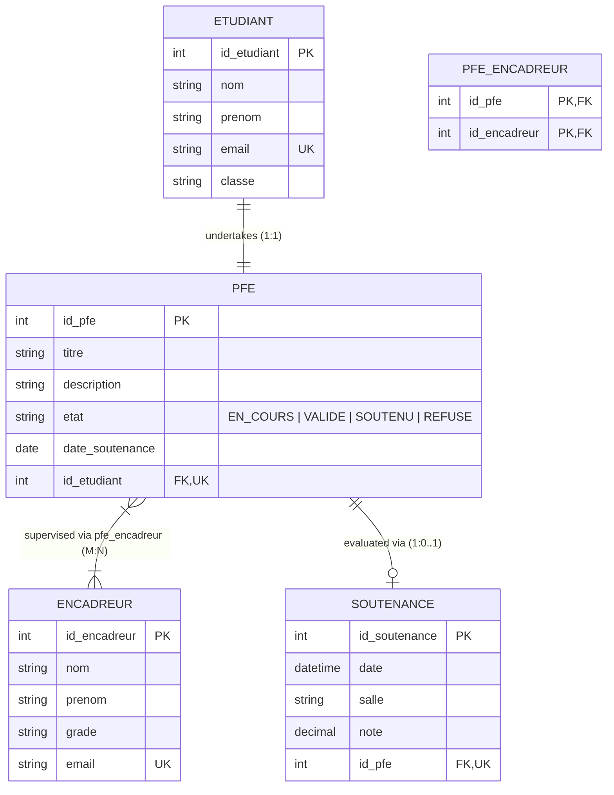

# Academic Project Management System (Gestion PFE)

[](https://www.oracle.com/java/)
[](https://docs.oracle.com/javase/tutorial/uiswing/)
[](https://www.mysql.com/)
[](LICENSE)

Desktop application developed in Java Swing and JDBC to manage the academic lifecycle of final-year engineering projects (PFE: *Projets de Fin d'Études*), defense hearings, students, and academic supervisors.

*Note: Pour la documentation en français, voir [README.fr.md](README.fr.md).*

## Architecture and Design

The application follows the **DAO (Data Access Object)** pattern to decouple the Swing user interface from the relational persistence layer.

- **Presentation Layer**: Custom Java Swing GUI (`JFrame`, `JTable`, `DefaultTableModel`, modal dialogs) organized into domain frames (`EtudiantFrame`, `EncadreurFrame`, `PfeFrame`, `SoutenanceFrame`, `DashboardFrame`).
- **Persistence Layer**: Data access objects (`EtudiantDao`, `EncadreurDao`, `PfeDao`, `SoutenanceDao`) executing parameterized SQL statements to safeguard against SQL injection.
- **Database Connection**: Direct JDBC connection management via `DriverManager.getConnection()`, reading connection parameters from `src/main/resources/db.properties` at runtime.

## Domain Model and Schema



### Lifecycle States

Project status (`PfeEtat`) transitions through four distinct states:
- `EN_COURS`: Project initiated and currently being developed.
- `VALIDE`: Deliverables approved by supervisor, ready for defense scheduling.
- `SOUTENU`: Defense hearing completed and final grade recorded.
- `REFUSE`: Project rejected or requiring substantial restructuring.

## Repository Structure

```
gestion-pfe/
├── .gitignore
├── LICENSE
├── README.md
├── README.fr.md
├── pom.xml
├── schema.sql
├── seed_data.sql
└── src/
    └── main/
        ├── java/tn/pfe/gestion/
        │   ├── dao/
        │   ├── db/
        │   ├── model/
        │   └── ui/
        └── resources/
            └── db.properties.example
```

## Getting Started

### Prerequisites

- Java Development Kit (JDK 8 or 17+)
- Apache Maven 3.8+
- MySQL Server 8.0+

### Database Setup

1. Create the database and tables:
   ```bash
   mysql -u root -p < schema.sql
   ```
2. (Optional) Load seed test data:
   ```bash
   mysql -u root -p < seed_data.sql
   ```
3. Configure credentials:
   Copy `src/main/resources/db.properties.example` to `src/main/resources/db.properties` and fill in your local MySQL credentials:
   ```properties
   db.url=jdbc:mysql://localhost:3306/gestion_pfe?useSSL=false&serverTimezone=UTC
   db.user=your_mysql_username
   db.password=your_mysql_password
   ```

### Build and Run

```bash
mvn clean compile
mvn exec:java -Dexec.mainClass="tn.pfe.gestion.Main"
```

## License

This project is licensed under the MIT License - see the [LICENSE](LICENSE) file for details.
